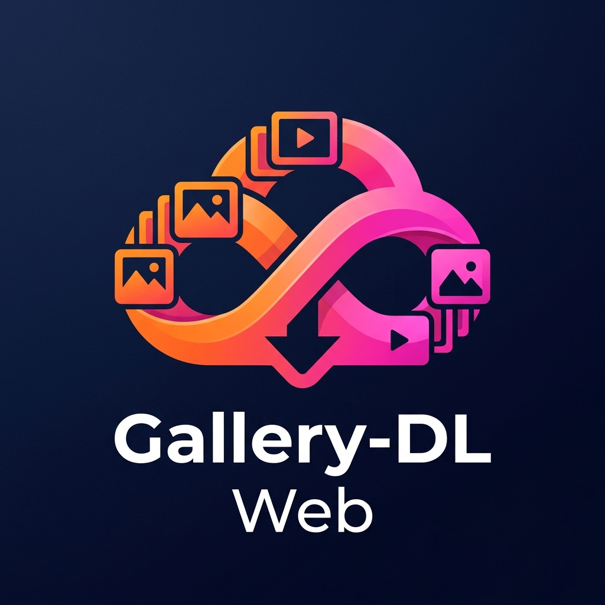
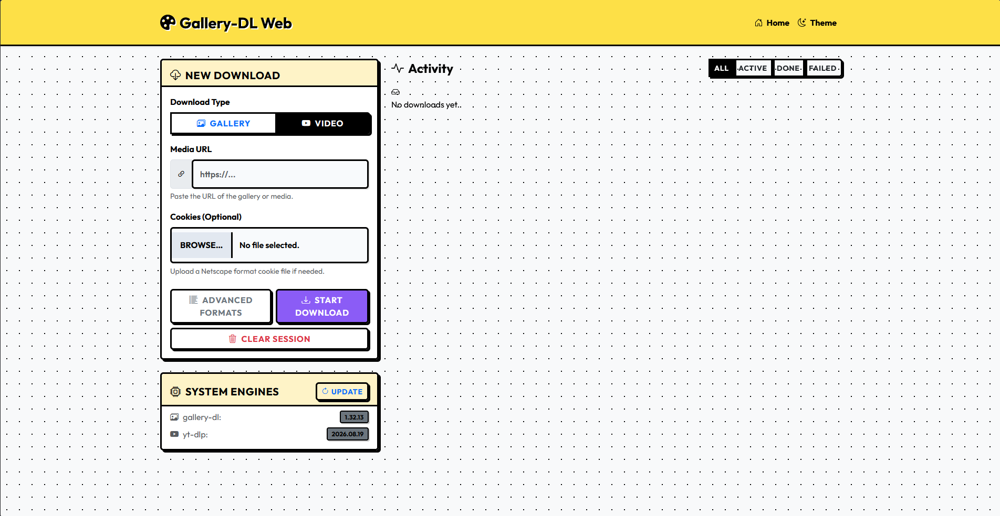
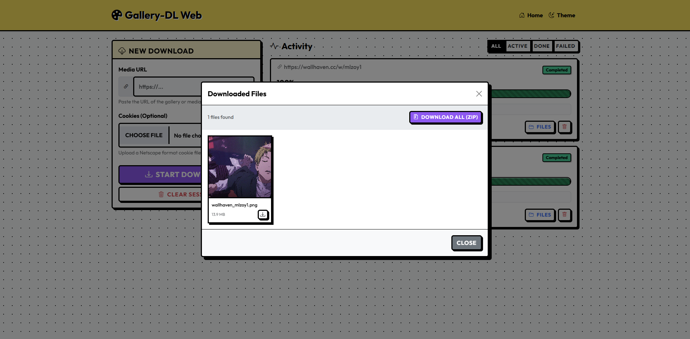
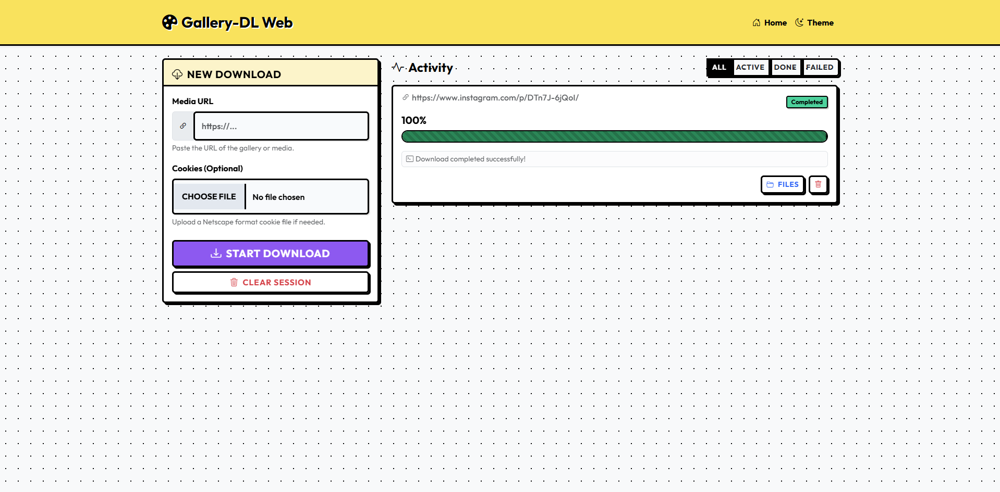
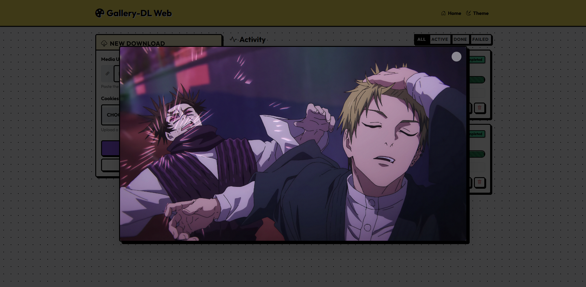
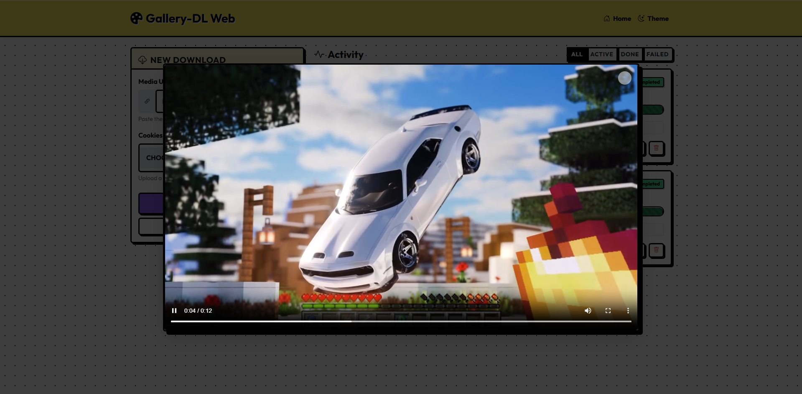

# GDL-Web

<div align="center">
  
</div>

<p align="center">
  <b>A modern, security-hardened, multi-user web interface for downloading galleries, videos, and media using <code>gallery-dl</code>, <code>yt-dlp</code>, and <code>ffmpeg</code>.</b>
</p>



## Features

- **Dual Download Engines**: Seamlessly download image galleries with [gallery-dl](https://github.com/mikf/gallery-dl) and videos/audio (with format inspection and `ffmpeg` remuxing) with [yt-dlp](https://github.com/yt-dlp/yt-dlp).
- **Modern Reactive UI**: Built with Svelte 5, TypeScript, and Vite for fast, accessible desktop and mobile workflows.
- **Real-Time Progress via Session-Scoped SSE**: Live download progress and status updates streamed over `/api/events`, strictly isolated per user session.
- **Persistent Multi-User State**: SQLite in WAL mode (`aiosqlite`) tracks downloads, sessions, and TTL expiration without in-memory state loss.
- **Constant-Memory Streaming ZIPs**: Download entire galleries as ZIP archives streamed directly from disk via `zipstream-ng`.
- **Encrypted Cookie Authentication**: Upload Netscape-format cookies for authenticated downloads; encrypted at rest with fail-fast Fernet (`cryptography`) and materialized transiently with `0700` permissions.
- **Unified Production Container**: Multi-stage Docker build (`node:22-alpine` + `python:3.12-alpine` + `ffmpeg`) used identically for local Docker Compose and Render (`runtime: docker`).

## Gallery

| Dashboard | Download Progress |
|:---:|:---:|
|  |  |
| **File Inline View** | **Video Preview** |
|  |  |

## Tech Stack

- **Backend**: FastAPI + Uvicorn (single async worker, `--proxy-headers`)
- **Database**: SQLite (WAL mode) via `aiosqlite`
- **Frontend**: Svelte 5 + TypeScript + Vite (`frontend/`)
- **Download Engines**: `gallery-dl`, `yt-dlp`, `ffmpeg`
- **Streaming Archives**: `zipstream-ng`
- **Security & Validation**: `pydantic` / `pydantic-settings`, `cryptography` (Fernet), `slowapi`
- **Quality & Testing**: `ruff`, `mypy`, `pytest` (`pytest-asyncio`, `pytest-cov`, `httpx`), `svelte-check`, `vitest`

## Quick Start with Docker Compose (Recommended)

### 1. Prepare environment variables

```bash
cp .env.example .env
```

Generate strong production secrets and place them in `.env`:

```bash
python -c "import secrets; print('SECRET_KEY=' + secrets.token_hex(32))"
python -c "from cryptography.fernet import Fernet; print('COOKIES_ENCRYPTION_KEY=' + Fernet.generate_key().decode())"
```

### 2. Start the container

```bash
docker compose up -d
```

On Windows PowerShell, you can also use the included helper script:

```powershell
.\gdl-web.ps1 up
.\gdl-web.ps1 logs
.\gdl-web.ps1 status
.\gdl-web.ps1 down
```

Open `http://127.0.0.1:6969` in your browser. For full container hardening details and standalone `docker run` instructions, see [README.Docker.md](README.Docker.md).

## Deploying to Render

GDL-Web includes a ready-to-use `render.yaml` Blueprint using `runtime: docker` so the compiled Svelte 5 frontend, Python 3.12 runtime, and `ffmpeg` run identically to local Docker:

1. Connect the repository in the Render dashboard as a Blueprint (or Web Service using Docker).
2. `render.yaml` automatically configures:
   - Health check at `/health`
   - A single persistent disk (`gdl-storage`, 10 GB) mounted at `/app/storage` (holding `downloads/`, `db/`, and `tmp_cookies/`)
   - Auto-generated `SECRET_KEY` and multi-user concurrency/TTL defaults (`MAX_CONCURRENT_DOWNLOADS_GLOBAL=6`, `MAX_CONCURRENT_DOWNLOADS_PER_SESSION=2`, `MAX_FILESIZE_MB=500`, `DOWNLOAD_TTL_SECONDS=3600`)
   - `ENABLE_RUNTIME_UPDATES=false`
3. Set `COOKIES_ENCRYPTION_KEY` in Render's Environment dashboard using a valid Fernet key generated with:

   ```bash
   python -c "from cryptography.fernet import Fernet; print(Fernet.generate_key().decode())"
   ```

## Security Architecture

GDL-Web is engineered for multi-user deployment with defense-in-depth controls:

- **Session-Scoped SSE & Storage Isolation**: Every browser session receives a signed session cookie; download history, files, and `/api/events` SSE streams are strictly scoped to the owning session.
- **SSRF Guard**: Submitted URLs are validated before spawning downloaders, blocking non-HTTP(S) schemes and private, loopback, link-local, multicast, and cloud metadata IP ranges.
- **Fail-Fast Fernet Cookie Encryption**: In production (`APP_ENV=production`), startup fails immediately if `SECRET_KEY` or a valid Fernet `COOKIES_ENCRYPTION_KEY` is missing or malformed. Decrypted cookies are written only for the duration of a subprocess inside a `chmod 700` directory and cleaned up immediately.
- **CSRF Protection**: State-changing API requests are protected against cross-site request forgery via `SameSite` cookies and CSRF/Origin verification.
- **Strict CSP & Security Headers**: Responses include a Content-Security-Policy (no inline script execution), `X-Content-Type-Options: nosniff`, `X-Frame-Options: DENY`, and `Referrer-Policy`.
- **Path Traversal Prevention & Streaming ZIPs**: All file reads/previews validate canonical paths inside the session's download root, and ZIP exports stream on the fly via `zipstream-ng`.
- **Rate Limiting & Quotas**: `slowapi` rate limits protect write/inspection endpoints, while global and per-session concurrency limits, `MAX_FILESIZE_MB`, and `DOWNLOAD_TTL_SECONDS` bound disk and CPU usage.
- **Container Hardening**: Runs as non-root `appuser` (UID `10001`) with application code owned by `root:root`. `compose.yaml` binds to `127.0.0.1`, enables `read_only: true`, drops all Linux capabilities (`cap_drop: [ALL]`), enforces `no-new-privileges:true`, caps `pids_limit: 256`, and leaves `ENABLE_RUNTIME_UPDATES=false` by default.

## Configuration

See [`.env.example`](.env.example) for all supported environment variables:

| Variable | Default | Description |
| --- | --- | --- |
| `APP_ENV` | `development` | `development`, `production`, or `testing` |
| `HOST` | `127.0.0.1` | Server bind address |
| `PORT` | `6969` | Listening HTTP port |
| `STORAGE_DIR` | `storage` (`/app/storage` in Docker) | Unified root for `downloads/`, `db/`, and `tmp_cookies/` |
| `SECRET_KEY` | *(required in prod)* | Secret key for signing sessions |
| `COOKIES_ENCRYPTION_KEY` | *(required in prod)* | 32-byte url-safe base64 Fernet key for encrypting cookies |
| `ENABLE_RUNTIME_UPDATES` | `false` | Enables/disables runtime engine updates via API |
| `LOG_LEVEL` | `INFO` | Logging verbosity (`DEBUG`, `INFO`, `WARNING`, `ERROR`) |
| `MAX_CONCURRENT_DOWNLOADS_GLOBAL` | `6` | Maximum concurrent downloads across all sessions |
| `MAX_CONCURRENT_DOWNLOADS_PER_SESSION` | `2` | Maximum concurrent downloads per session |
| `MAX_FILESIZE_MB` | `500` | Maximum individual media file size limit (MB) |
| `DOWNLOAD_TTL_SECONDS` | `3600` | Retention window before expired downloads are purged |

## API Endpoints

| Method | Endpoint | Description |
| --- | --- | --- |
| `GET` | `/health` | Health check probe for Docker and Render |
| `GET` | `/api/events` | Session-scoped Server-Sent Events (SSE) progress stream |
| `POST` | `/api/download` | Start a new download (`url`, `tool`, optional `format_id` & `cookies`) |
| `POST` | `/api/formats` | Inspect available `yt-dlp` formats for a URL |
| `GET` | `/api/downloads` | List all downloads belonging to the current session |
| `GET` | `/api/status/{download_id}` | Fetch detailed status and progress of a session download |
| `DELETE` | `/api/downloads/{download_id}` | Delete a download record and its files |
| `POST` | `/api/cancel/{download_id}` | Cancel an active download subprocess |
| `POST` | `/api/clear-history` | Clear finished/failed download history for the current session |
| `POST` | `/api/session/clear` | Wipe all downloads and stored cookies for the current session |
| `GET` | `/api/files/{download_id}` | List downloaded media files for a job |
| `GET` | `/api/download-file/{download_id}/{filename}` | Stream or preview a single downloaded file |
| `GET` | `/api/download-zip/{download_id}` | Stream all files in a job as a ZIP archive (`zipstream-ng`) |
| `GET` | `/api/stats` | Get session download statistics |
| `GET` | `/api/config` | Get public runtime configuration and limits |
| `GET` | `/api/system/engines` | Report installed `gallery-dl`, `yt-dlp`, and `ffmpeg` versions |
| `POST` | `/api/system/engines/update` | Update download engines (only when `ENABLE_RUNTIME_UPDATES=true`) |

## Local Development

### Prerequisites

- Python 3.12+
- Node.js 22+ and npm
- `ffmpeg` on `PATH` (for video/audio merging via `yt-dlp`)

### 1. Backend Setup

```bash
python -m venv .venv
# Linux/macOS:
source .venv/bin/activate
# Windows (PowerShell):
.\.venv\Scripts\Activate.ps1

pip install -r requirements-dev.txt
cp .env.example .env
```

Start the FastAPI backend with Uvicorn:

```bash
uvicorn --factory app.main:create_app --host 127.0.0.1 --port 6969 --reload
# or
python run.py
```

### 2. Frontend Setup

```bash
cd frontend
npm ci
npm run dev
```

Vite serves the Svelte 5 dev server with API proxying to the backend. To build the static production bundle served by FastAPI from `frontend/dist/`:

```bash
cd frontend
npm run build
```

### 3. Linting, Type-Checking & Tests

All Python tooling is unified in `pyproject.toml`:

```bash
# Backend checks
ruff check app tests
mypy app
pytest

# Frontend checks
cd frontend
npm run check
npm test
npm run build
```

Continuous Integration runs all backend checks, frontend checks, and a full `docker build` verification automatically via [`.github/workflows/ci.yml`](.github/workflows/ci.yml).

## License

This project is licensed under the MIT License — see [LICENSE](LICENSE) for details.
